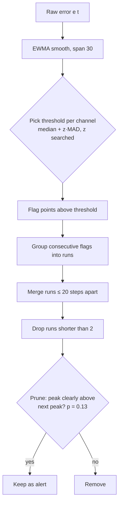

<div align="center">

# Spacecraft Telemetry Anomaly Detection
### An LSTM next-step predictor for NASA SMAP and MSL telemetry


-orange)


*Predict what a spacecraft sensor should read next. When the reading arrives and disagrees
with the prediction, something may be wrong.*

</div>

---

## Contents

1. [The idea in one minute](#1-the-idea-in-one-minute)
2. [Background: what is telemetry?](#2-background-what-is-telemetry)
3. [The data](#3-the-data)
4. [Pipeline at a glance](#4-pipeline-at-a-glance)
5. [Concepts explained](#5-concepts-explained)
6. [Training the model](#6-training-the-model)
7. [Turning errors into alerts](#7-turning-errors-into-alerts)
8. [Evaluation: how we score a detector](#8-evaluation-how-we-score-a-detector)
9. [Results](#9-results)
10. [Decisions and data quality](#10-decisions-and-data-quality)
11. [Limitations and honest comparison](#11-limitations-and-honest-comparison)
12. [Reproduce it](#12-reproduce-it)
13. [Repository map](#13-repository-map)
14. [Glossary](#14-glossary)
15. [References](#15-references)

---

## 1. The idea in one minute

A spacecraft has hundreds of sensors (temperature, power, radiation, valve states) sending
numbers back to Earth every few seconds. Engineers cannot watch them all. So we train a
model on **normal** data to learn what each sensor usually does, then use it to flag the moments
when a sensor stops behaving normally.

The method is a **prediction-error detector**:

```
          past 250 readings              model                 next reading
 ──► [ x(t-250) ... x(t-1) ]  ──►  LSTM  ──►  predicted x̂(t)     vs     actual x(t)
                                                                 │
                                       error  e(t) = |x(t) − x̂(t)|
                                                                 │
                                  smooth ─► threshold ─► alerts ─► score against labels
```

If the model predicted well, the error is small. If the sensor suddenly does something the
model has never seen, the error spikes, and we raise an alert.

---

## 2. Background: what is telemetry?

**Telemetry** is the stream of measurements a spacecraft sends home. Each stream is a
**channel**, identified by a code such as `P-1`. The first letter is the subsystem, following the
dataset's naming convention (for example `P` for power, `R` for radiation, `E` for an
engineering channel). Each channel is a time series sampled at a fixed rate.

Two kinds of signal arrive on each channel:

| Signal | What it is | Example |
|---|---|---|
| **Telemetry value** (column 0) | The measured quantity itself | Battery voltage, temperature |
| **Command signals** (columns 1 onward) | One-hot flags for commands sent *to* the spacecraft | "Heater on", "Mode 3 selected" |

Command columns are binary: a command is either active (1) or not (0). A command changes the
telemetry, so the model uses both signals together. Knowing that a heater was just commanded on
helps predict the temperature that follows.

---

## 3. The data

The dataset is NASA's SMAP/MSL benchmark, released with Hundman et al. (2018). It is split into
a **training** part, which contains no labeled anomalies and represents normal operation, and a
**test** part, which contains the labeled anomalies.

| | SMAP | MSL | Total |
|---|---|---|---|
| Channels | 55 | 27 | 82 |
| Input dimensions (telemetry + commands) | 25 | 55 | |
| Labeled anomaly intervals | 69 | 36 | 105 |
| Point anomalies | 43 | 19 | 62 |
| Contextual anomalies | 26 | 17 | 43 |

**Labels.** `labeled_anomalies.csv` lists, for each channel, the test-set index ranges that are
anomalous, such as `[[5300, 5747]]`, plus the anomaly class (`point` or `contextual`).

**Test-set indices.** Every label is an index into the *test* series, counted from 0. Keep this
in mind throughout: an index in the saved predictions must be shifted by the window length before
it can be compared with a label (see [section 5.6](#56-the-offset-that-trips-everyone-up)).

---

## 4. Pipeline at a glance

```mermaid
flowchart LR
    A[Raw telemetry<br/>train / test .npy] --> B[MinMax scaling<br/>fit on train only]
    B --> C[Sliding windows<br/>250 steps → next value]
    C --> D[LSTM predictor<br/>one model per channel]
    D --> E[Predictions on test<br/>ŷ for every step]
    E --> F[Absolute error<br/>e = |y − ŷ|]
    F --> G[EWMA smoothing<br/>span 30]
    G --> H[Dynamic threshold<br/>median + z·MAD]
    H --> I[Alerts<br/>merge gaps, prune weak]
    I --> J[Event-level scoring<br/>TP / FP / FN]
    L[labeled_anomalies.csv] --> J
```

Each stage has one job, and each can be tested on its own. The notebook runs them in the order
shown: train, predict, detect, evaluate.

---

## 5. Concepts explained

### 5.1 Time series and the next-step prediction task

A time series is an ordered sequence `x(0), x(1), …, x(T)`. The predictive task is:

> Given `x(t−250), …, x(t−1)`, estimate `x(t)`.

The model never sees `x(t)` when it makes its prediction, so a large miss means the sensor
behaved in a way the recent past did not suggest. That gap is the anomaly signal.

### 5.2 Min-max scaling

Sensors measure in different units, so every column is rescaled to the range [0, 1]:

```
x_scaled = (x − min_train) / (max_train − min_train)
```

Two rules matter here.

- **Fit on training data only.** The minimum and maximum come from the training series. Fitting on
  test data would leak information about what the test set looks like.
- **Guard against zero range.** If a column is constant in training, dividing by zero is impossible,
  so the scale is set to 1. This keeps the code from failing, but it also means a constant column
  gives no useful scaling. See [section 10](#10-decisions-and-data-quality).

Test values are scaled with the **training** minimum and maximum, so they can fall outside [0, 1].
That is intentional: a value outside the training range is informative.

### 5.3 Sliding windows

The LSTM needs fixed-length input. A **window** of 250 consecutive steps slides one step at a
time across the series, and each window is paired with the value that follows it:

```
time →   0    1    2   ...  249 | 250     ← target
         └──── window (250) ───┘  x(250)

         1    2    3   ...  250 | 251     ← next window, next target
```

For a training series of length `T`, this gives `T − 250` (window, target) pairs. Windows are
created with `unfold`, which returns a view rather than copying data, so memory stays low.

### 5.4 Long short-term memory (LSTM)

A plain recurrent network passes a hidden state from step to step. It struggles to keep
information over long spans, because gradients shrink as they travel back through time. An
**LSTM** fixes this with gated memory:

```
          ┌───────────── cell state c(t) ─────────────┐
          │                                           │
 x(t) ───►│  forget gate  f  ─┐                       ├──► h(t)  (output)
 h(t-1) ─►│  input gate   i  ─┼──► update c(t)        │
          │  output gate  o  ─┘                       │
          └───────────────────────────────────────────┘
```

- **Forget gate** decides what to erase from memory.
- **Input gate** decides what new information to write.
- **Output gate** decides what to reveal as the hidden output.

This model stacks **two LSTM layers of 80 units each**, with dropout 0.3 between them. A final
linear layer maps the last hidden state to one number, the predicted next value. The total is
**86,161 parameters**, small enough to train in seconds on a GPU.

```python
class LSTMPredictor(nn.Module):
    def __init__(self, n_features, hidden=80, layers=2, dropout=0.3):
        self.lstm = nn.LSTM(n_features, hidden, num_layers=layers, batch_first=True, dropout=dropout)
        self.head = nn.Linear(hidden, 1)
    def forward(self, x):                     # x: (batch, 250, features)
        out, _ = self.lstm(x)
        return self.head(out[:, -1]).squeeze(-1)   # predict from the last time step
```

### 5.5 Dropout and regularization

**Dropout** randomly zeros 30% of connections during training. It forces the network not to rely
on any single pathway, which reduces overfitting. Dropout is switched off at evaluation time.

### 5.6 The offset that trips everyone up

The first prediction needs 250 steps of history, so the model cannot predict test indices
`0` to `249`. Each saved prediction array therefore starts at test index **250**:

```
saved array index i   ↔   test timestep i + 250
```

Every saved file records this as `offset = 250`. Forgetting the shift does not crash the code.
It silently moves every alert 250 steps away from its anomaly and wrecks the scores. The
detection code adds the offset back before any comparison.

### 5.7 Chronological validation split

Random shuffling would leak future information into training, so the last **20%** of the training
series is held out for validation, in time order. Windows inside the training part may be shuffled,
but the split itself never is. The validation windows borrow 250 steps of context from just before
the split, so the first validation prediction is well defined.

### 5.8 Early stopping

Training runs for at most 35 epochs. After each epoch the validation error is measured. The best
weights are kept, and training stops if the validation error has not improved by at least `3e-4`
for 10 consecutive epochs (**patience**). This prevents the model from memorizing noise.

The training log from the notebook shows the pattern: validation loss falls quickly over the first
20 epochs, then flattens while the training loss keeps creeping down. Early stopping keeps the
weights from the best validation point, not the last one.

### 5.9 Gradient clipping and Adam

**Adam** adapts the learning rate for each parameter (here `1e-3`). **Gradient clipping** caps the
size of each update at 1.0, so one unusual batch cannot blow up the weights. Together they keep
training stable on the noisy telemetry.

### 5.10 Mean absolute error and mean squared error

- **MSE** (training loss): `mean((y − ŷ)²)`. It penalizes large errors heavily, so the optimizer
  focuses on big misses.
- **MAE** (reported as `test_mae`): `mean(|y − ŷ|)`. It is easier to read, because it is in the same
  units as the scaled telemetry.

### 5.11 EWMA smoothing

Raw prediction errors are spiky: a single noisy step can cross the threshold. An **exponentially
weighted moving average** smooths them, giving recent values more weight:

```
s(t) = α · e(t) + (1 − α) · s(t − 1),     α = 2 / (span + 1)
```

With `span = 30`, the smoothing horizon is about 30 steps. Single-step spikes are damped, while
sustained errors (a real anomaly) stay high. Smaller spans react faster and produce more alerts;
larger spans are steadier and miss short events.

### 5.12 Robust statistics: median and MAD

A threshold based on the mean and standard deviation is pulled upward by the very anomalies we
want to catch. A long anomaly, such as `[3539, 3779]` in a channel with a 2,000-step test series, can
inflate the mean and standard deviation enough to hide itself.

The **median** and the **median absolute deviation** (MAD) are not affected by a minority of large
values:

```
centre  = median(s)
spread  = 1.4826 × median(|s − centre|)      (1.4826 makes MAD comparable to a standard deviation)
```

The threshold is `centre + z · spread`. In the test with synthetic data, the plain mean/standard
deviation version missed three long anomalies that the robust version caught. The notebook still
prints both so you can see the difference.

### 5.13 Dynamic threshold (Telemanom-style)

There is no single correct threshold, so the detector chooses one per channel. It tries many values
of `z` (from 2.5 to 30 in steps of 0.5) and scores each:

```
score(z) = [ relative drop in mean  +  relative drop in std ]  /  ( number_of_sequences² + number_of_points )
```

The "drop" is how much the mean and standard deviation of the *remaining* errors fall after the
flagged points are removed. A good threshold removes a lot of variation while flagging few points
in few sequences. The search keeps only thresholds with at most 10 alert sequences and at most half
of all points flagged.

This is an adaptation of the approach in Hundman et al. (2018), chosen so that each channel gets
its own threshold without any labels.

### 5.14 Alerts: grouping and merging

Consecutive flagged timesteps form a **run**. Two runs separated by 20 steps or fewer are
**merged** into one alert, because a real anomaly often flickers around the threshold. Alerts shorter
than 2 steps are discarded.

### 5.15 Pruning weak alerts

Some alerts are only barely above the threshold. Pruning removes an alert when its peak is not
clearly higher than the next-highest peak. The comparison includes the highest error seen during
normal operation, so an alert must stand clearly apart from ordinary noise:

```
for alerts sorted by peak height:   drop alert i  if  (peak_i − peak_{i+1}) / peak_i  <  p
```

The default is `p = 0.13`, meaning an alert must be at least 13% higher than the next one.
Setting `p = 0.0` disables pruning. This is the most important setting in the detector, and it is
analyzed in [section 9.3](#93-sensitivity-analysis).

---

## 6. Training the model

| Setting | Value | Why |
|---|---|---|
| Window | 250 | Long enough to capture the normal cycle of most channels |
| Hidden units / layers | 80 / 2 | Enough capacity without overfitting ~2,500 training windows |
| Dropout | 0.3 | Regularization between LSTM layers |
| Batch size | 64 | Stable gradients, fast on a T4 |
| Learning rate | 1e-3 (Adam) | Standard starting point |
| Max epochs / patience | 35 / 10 | Early stopping on validation loss |
| Validation fraction | 20% (chronological) | No future leakage |
| Seed | 42 | Reproducible runs |

**Training is per channel.** Each of the 82 channels gets its own model, because each sensor has
its own behaviour. A typical run takes about 15 seconds per channel on a T4 GPU, so the full
training takes roughly 20 to 45 minutes.

**Typical training trace** (channel P-1): training MSE falls from 0.035 to about 0.007 in 35
epochs, and validation MSE follows it closely (from 0.028 to about 0.007). The two curves staying
close means the model generalizes rather than memorizes.

---

## 7. Turning errors into alerts



The output is a list of `(start, end)` pairs in test-timestep coordinates, which is what the scoring
step consumes.

---

## 8. Evaluation: how we score a detector

### 8.1 Why not accuracy?

Anomalies are rare. If 2% of timesteps are anomalous, a detector that never alarms is 98% accurate and
completely useless. Accuracy is therefore not reported.

### 8.2 Event-level scoring

We score **events**, not timesteps. This matches how operators work: one alert on an anomaly is
useful, whether it covers the first step or the last.

- **True positive (TP):** a labeled anomaly overlapped by at least one alert.
- **False negative (FN):** a labeled anomaly with no overlapping alert.
- **False positive (FP):** an alert that overlaps no labeled anomaly.

Overlap is tested with two inclusive intervals `[a₁, a₂]` and `[b₁, b₂]`:

```
overlap  ⟺  a₁ ≤ b₂  and  b₁ ≤ a₂
```

Multiple alerts on one anomaly count as **one** TP, not several, so a long anomaly cannot be
rewarded for being hit many times.

### 8.3 Precision, recall, F1

```
precision = TP / (TP + FP)     "of the alerts raised, how many were real?"
recall    = TP / (TP + FN)     "of the real anomalies, how many did we catch?"
F1        = 2 · precision · recall / (precision + recall)
```

Precision and recall pull against each other. Lowering the threshold raises recall and lowers
precision. F1 summarizes both in one number, and it is the main figure in this project.

### 8.4 Point versus contextual anomalies

- **Point anomaly:** a single value that is abnormal on its own. A sudden spike is the classic case.
- **Contextual anomaly:** a value that is normal in isolation but wrong for the situation. A
  temperature that is fine in daylight but dangerous at night is the typical example.

A next-step predictor compares each value against what it expected from the immediate past, so it
should find point anomalies more easily than contextual ones. The results below confirm this.

### 8.5 Pre-committed settings

The main setting (`p = 0.13`) was fixed before the full 82-channel run. Other settings are reported
as **sensitivity checks**. Choosing the best-scoring setting after seeing the test labels would make
the result look better than the method really is, so it is avoided.

---

## 9. Results

### 9.1 Main result

Pre-committed setting, 78 channels (see section 10 for the four excluded):

| Subset | TP | FP | FN | Precision | Recall | F1 |
|---|---|---|---|---|---|---|
| **All** | 37 | 30 | 64 | **0.552** | **0.366** | **0.440** |
| SMAP | 27 | 29 | 40 | 0.482 | 0.403 | 0.439 |
| MSL | 10 | 1 | 24 | **0.909** | 0.294 | 0.444 |

**Reading the table.** MSL is very precise: one false alarm in 11 alerts across its channels. SMAP
finds a slightly higher share of its anomalies but raises 29 false alarms, most of them from one
channel (section 10.4).

### 9.2 Point versus contextual

| Anomaly type | Found | Total | Recall |
|---|---|---|---|
| Point | 30 | 58 | 52% |
| Contextual | 7 | 43 | 16% |

The gap is the clearest finding in the project. The detector is a good spike detector and a weak
context detector.

### 9.3 Sensitivity analysis

These are reported to show how fragile the result is. None of them replaces the main result.

| Check | Channels | TP | FP | FN | Precision | Recall | F1 |
|---|---|---|---|---|---|---|---|
| Main (p = 0.13) | 78 | 37 | 30 | 64 | 0.552 | 0.366 | 0.440 |
| Include P-10, P-14 | 80 | 39 | 30 | 64 | 0.565 | 0.379 | 0.453 |
| Pruning off (p = 0.0) | 80 | 53 | 49 | 50 | 0.520 | 0.515 | 0.517 |
| Clipped test inputs | 80 | 39 | 30 | 64 | 0.565 | 0.379 | 0.453 |

**Pruning is a trade-off, not a free improvement.** Turning it off finds 16 more anomalies (recall
rises from 0.37 to 0.52) but adds 19 false alarms, so precision falls. F1 is slightly higher, but the
choice should be made by what the operators can tolerate, not by F1 alone.

**Clipping had no effect.** The test-set values sit so far outside the training range (see section 10.3)
that clamping them to [−0.5, 1.5] barely changes the predictions, and every metric is identical.

---

## 10. Decisions and data quality

Real data needed several decisions. Each one is recorded here so the reader can judge it.

### 10.1 Excluded: D-12

Its training series has **312** steps. A 250-step window plus a 20% validation split leaves too few
windows to train, so the notebook skips it. It is counted as not evaluated.

### 10.2 Excluded from the main result: P-10 and P-14

Their **test files are byte-identical**, but their labels disagree: P-10 is anomalous at 4590–4720,
P-14 at 4575–4755. The same telemetry cannot match both. Because we cannot tell which label is right,
both channels are excluded from the main result and reported in a sensitivity check.

### 10.3 Corrected: P-2 duplicate labels

P-2 appears twice with near-identical intervals, `[5350, 6575]` and `[5300, 6420]`. These overlap almost
completely, so they were merged into one interval, `[5300, 6575]`. The earlier evaluation read only the
first row, so this merge is the correct version.

### 10.4 Unscored: T-10

T-10 has training and test data but no label row, so it cannot be scored.

### 10.5 Near-constant training telemetry

Several channels have almost no variation in training:

| Channel | Training std | What happens |
|---|---|---|
| A-1, R-1 | ~1e-16 | Training is a flat line at 0.999 |
| D-5, P-14, E-6, P-10 | 1e-4 to 3e-3 | Nearly flat |

A model trained on a flat line predicts a flat line. Any real movement in the test data then looks
like error. Scaling cannot fix this, because the problem is the lack of training variation, not the
range. These channels are kept in the results and reported as a failure mode.

### 10.6 Test values outside the training range

For most channels the test telemetry stays within the training range. A few, such as A-1, R-1 and
D-5, sit almost entirely outside it. The magnitude check (`mean_below_frac`) shows the offset is
measured in multiples of the tiny training range, which is the same near-constant problem as above.

### 10.7 The G-7 false-alarm cluster

G-7 produces **31 alerts**, of which **28 are false**. Its labeled anomalies are at 3650–3750,
5050–5100 and 7560–7675, but its alerts are spread across roughly 1,200–8,000. The error stays high
across much of the series, so the threshold keeps being crossed. This points to unstable normal
behaviour in G-7 rather than to many real anomalies. It accounts for 28 of the 29 SMAP false alarms.

---

## 11. Limitations and honest comparison

**Compared with published work.** The Telemanom README reports precision 0.855, recall 0.800 and
F1 0.71 on this data. Our main result is F1 0.440. The gap is real and should be stated plainly.

Likely reasons, none of which we have tested:

- Telemanom predicts several steps ahead, not one. A multi-step error is harder to satisfy by
  chance, which tends to improve contextual detection.
- Its threshold and pruning are tuned in ways not fully reproduced here.
- We use one next-step error per timestep, with no ensembling.

**Other limitations**

- Contextual anomalies are mostly missed (16%).
- Near-constant training channels cannot be modelled from training data alone.
- One channel (G-7) dominates false alarms.
- Event-level scoring rewards catching an anomaly at all, not catching it early or precisely.
- Results come from a single seed (42). Variance across seeds is not measured.

---

## 12. Reproduce it

**Requirements.** A Google account and Google Colab. A T4 GPU is recommended; the notebook also runs
on CPU, but slowly.

**Steps**

1. Open `code/smap_msl_lstm_train.ipynb` in Colab.
2. `Runtime → Change runtime type → T4 GPU`.
3. `Runtime → Run all`, and allow Google Drive access.
4. The data downloads automatically. Models and predictions are saved to
   `MyDrive/anomaly/outputs/` so a disconnect loses at most one channel.
5. Compare your summary with `results/summary.csv`.

**Local use.** Install the packages in `requirements.txt`, place the dataset in `/content/data` or
edit `DATA_ROOT`, then run the notebook top to bottom. Setting `QUICK_TEST = True` trains only three
channels, which is useful for checking that everything runs.

**Expected run time.** About 15 seconds per channel on a T4, 20 to 45 minutes overall.

---

## 13. Repository map

```
anomaly_project/
├── code/
│   └── smap_msl_lstm_train.ipynb     full pipeline: data → train → detect → evaluate
├── results/
│   ├── summary.csv                   headline numbers for each setting
│   └── anomaly_type_breakdown.csv    point versus contextual detection rates
├── report/
│   └── REPORT.md                     method, results and limitations in prose
├── README.md                         this file
├── requirements.txt                  Python dependencies
└── .gitignore                        excludes trained models, predictions and data
```

---

## 14. Glossary

| Term | Meaning |
|---|---|
| **Telemetry** | Measurements a spacecraft sends back to Earth |
| **Channel** | One telemetry stream, such as `P-1` |
| **Command signal** | Binary flag recording a command sent to the spacecraft |
| **Window** | A fixed-length run of past steps fed to the model |
| **Offset** | The 250-step shift between prediction indices and test indices |
| **LSTM** | Recurrent network with gated memory for long sequences |
| **Dropout** | Randomly disabling connections during training to reduce overfitting |
| **Early stopping** | Halting training when validation error stops improving |
| **EWMA** | Exponentially weighted moving average, used to smooth errors |
| **MAD** | Median absolute deviation, a robust measure of spread |
| **Threshold (z)** | How many robust spreads above the centre an error must be to alarm |
| **Alert** | A contiguous run of flagged timesteps after merging and pruning |
| **Point anomaly** | A value that is abnormal on its own |
| **Contextual anomaly** | A value that is abnormal only given its surroundings |
| **TP / FP / FN** | True positive, false positive, false negative (event-level) |
| **Precision / recall / F1** | Share of alerts that are real / share of anomalies found / their harmonic mean |
| **Pruning (p)** | Removing alerts that are not clearly above the next-highest peak |

---

## 15. References

- Hundman, K., Constantinou, V., Laporte, C., Colwell, I., & Soderstrom, T. (2018).
  *Detecting Spacecraft Anomalies Using LSTMs and Nonparametric Dynamic Thresholding.* KDD 2018.
- Hochreiter, S., & Schmidhuber, J. (1997). *Long Short-Term Memory.* Neural Computation.
- Telemanom reference implementation: https://github.com/khundman/telemanom

<div align="center">

*Built for a class project. Results are reported as measured, including the parts that are weak.*

</div>
